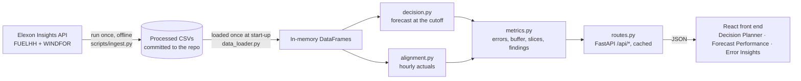

# Architecture

## Data flow

**Why the data is pre-fetched:** January 2026 is history and does not change. Fetching it once
removes a runtime dependency on Elexon (downtime, rate limits, slow responses) and makes every
number reproducible from the committed CSVs. `scripts/ingest.py` can rebuild them at any time.

## Back end (`backend/app`)

| Module | Responsibility |
|---|---|
| `config.py` | Date bounds, default cutoff and cutoff options, file paths, environment settings (`CORS_ORIGINS`, `STATIC_DIR`). |
| `data_loader.py` | Reads the CSVs once (`get_dataset`, cached) and builds hourly actuals. |
| `decision.py` | **Core rule.** `select_decision_forecast(forecasts, delivery_date, cutoff)`: for each of the 24 hours, the forecast with the latest `publish_time <= cutoff on D-1`; otherwise the hour is missing. Pure pandas, no web code. |
| `alignment.py` | `hourly_actuals`: mean of the two half-hours, or null if one is missing. |
| `metrics.py` | Pairs of decision forecast and actual; MAE, RMSE, bias, normalised MAE, percentiles, shortfall buffer; slices by hour, wind level, day, horizon and cutoff; naive baseline; bootstrap ranges by whole days; look-ahead comparison; buffer without hindsight; plain-language findings. |
| `routes.py` | The `/api` endpoints, input checks (dates within January, listed cutoffs only → 422) and per-request caches. Expensive results for the default views are computed at start-up. |
| `schemas.py` | Pydantic response models; they drive the OpenAPI schema at `/docs`. |
| `main.py` | FastAPI app, CORS from the environment, gzip, security and cache headers, and the built front end served at `/` when present. |

### Avoiding look-ahead leakage

Forecasts are republished up to 8 times a day. A buyer deciding at 09:00 on D-1 could only have
seen forecasts published by then. `decision.py` filters on `publish_time <= cutoff`
(inclusive) *before* choosing the latest one per hour, and never falls back to a later publish.
Tests cover the edge cases (publish exactly at the cutoff, newer publish after it, partial
coverage, the golden example). The Error Insights look-ahead check shows what leakage would have
done: the MAE would look like 1,814 MW instead of 2,142 MW.

### API

| Endpoint | Returns |
|---|---|
| `GET /api/health` | liveness |
| `GET /api/meta` | date bounds, cutoff options, data notes |
| `GET /api/decision-forecast?delivery_date&cutoff` | 24 hourly points, publish times used, horizons, buffers, bias |
| `GET /api/series?from&to&cutoff` | hourly forecast, actual and error |
| `GET /api/metrics?from&to&cutoff` | overall metrics with 90% ranges, slices, baseline, look-ahead check, buffer without hindsight, findings |
| `GET /api/error-by-horizon?from&to` | MAE and bias by lead-time bucket |
| `GET /api/cutoff-sensitivity?from&to` | MAE, bias and buffer for each cutoff |

## Front end (`frontend/src`)

React + TypeScript + Vite + Recharts.

- `api/`: a typed client and types that mirror `schemas.py`. Successful responses are cached for
  the life of the page.
- `lib/`: pure helpers with Vitest tests: formatting (always UTC), banner text, chart rows, buy
  plan, histogram, CSV, URL state.
- `pages/`: the three views. `components/`: cards, KPI tiles, controls, the Methodology panel, and
  the loading, error-with-retry and empty states.
- View state (tab, date, cutoff, range) is mirrored in the URL for shareable links.

## Deployment

- **Docker:** a multi-stage `Dockerfile`. Node builds the front end; `python:3.12-slim` serves
  the API and the static files with uvicorn on `$PORT`, as a non-root user. `docker-compose.yml`
  adds a health check.
- **Vercel (live):** `vercel.json` builds the front end as static files and routes `/api`, `/docs`
  and `/openapi.json` to `api/index.py`, a Python function wrapping the same FastAPI app with the
  CSVs bundled. Security headers for static files are set in `vercel.json`.

## Quality

- `pytest` (93 tests) and `ruff` lint and format for the back end; Vitest (23 tests) and a
  type-checked production build for the front end.
- GitHub Actions runs all of these, a Docker build, and `pip-audit` / `npm audit`
  (informational) on every push.
